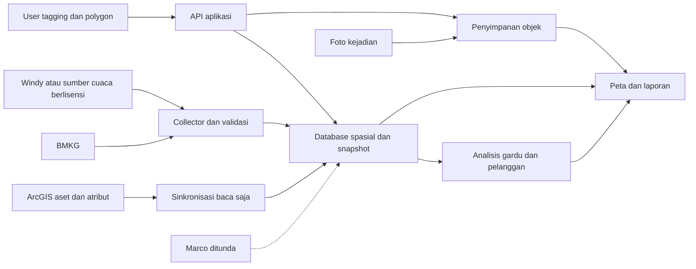

# PRD Web App GRIDCAST

> Catatan 29 Oktober 2026: aplikasi kini bernama **GRIDCAST** (Weather Intelligence & Grid Asset Monitoring, PLN UP2D Sumatera Barat). Isi dokumen ini ditulis saat aplikasi masih bernama Disaster Information Center; istilah teknis seperti database `disaster_center` tetap.

Versi 0.3 · 28 Oktober 2026 · Wilayah seluruh Sumatera Barat · Status spesifikasi pengembangan untuk review DCC, GIS dan TI/OT.

Disaster Information Center menggabungkan jaringan distribusi 20 kV, cuaca dan dokumentasi bencana pada satu peta. ArcGIS menjadi sumber utama aset; BMKG menyediakan peringatan resmi; Windy menjadi kandidat visualisasi cuaca. Pengguna dapat mencatat lokasi kejadian, menyimpan polygon dampak dan foto, lalu memperoleh rekap gardu serta pelanggan di dalam area tersebut. Aplikasi mendukung keputusan operator dan tidak menjalankan switching.

Dokumen ini memperbarui spesifikasi, bukan laporan bahwa seluruh fitur sudah terpasang. Kondisi prototipe dicatat terpisah pada bagian 3. Keputusan terbaru pengguna: konektor Marco ditunda; referensi hijaunya berarti gardu menyala dan merah berarti padam. Istilah “awan Columbus” ditafsirkan sementara sebagai cumulonimbus atau Cb.

## 1 Tujuan dan lingkup

Operator perlu mengetahui lokasi ancaman, aset yang terpapar, jumlah pelanggan pada gardu terpilih, serta riwayat kejadian. Hasil yang dituju adalah peta jaringan yang mengikuti perubahan pada sumber ArcGIS, peringatan yang dapat ditelusuri, dan dokumentasi dampak yang tersimpan permanen.

Rilis pertama berfokus pada ArcGIS, BMKG, pencatatan bencana, polygon, rekap pelanggan, foto dan hak akses. Cuaca visual ditambahkan melalui pilot Windy. Radar/nowcast untuk analisis otomatis, petir aktual presisi dan indikasi Cb diaktifkan sesuai kemampuan produk data yang sudah diverifikasi. Integrasi Marco tetap berada di backlog ditunda dan tidak menjadi penghambat rilis pertama.

Di luar lingkup: perintah SCADA, perubahan proteksi, kesimpulan kerusakan otomatis dari warna cuaca, jaminan bebas risiko karena tidak ada peringatan, dan prediksi titik sambaran petir pasti. Pengurangan gangguan merupakan hipotesis manfaat yang perlu diukur pada pilot.

## 2 Peran dan hak akses

| Kemampuan | Admin | User | Guest tanpa login |
|---|---|---|---|
| Melihat peta, cuaca dan kejadian | Ya | Ya | Ya, pada lapisan tampilan guest |
| Membuat dan mengubah tagging kejadian | Ya | Ya | Tidak |
| Menggambar, mengubah dan menyimpan polygon | Ya | Ya | Tidak |
| Menjalankan analisis gardu dan pelanggan | Ya | Ya | Melihat ringkasan yang dipublikasikan |
| Mengunggah foto dan memperbarui dokumentasi | Ya | Ya | Tidak; melihat dokumentasi yang diizinkan |
| Mengelola status kejadian dan peninjauan alert | Ya | Ya | Tidak |
| Mengelola akun dan peran | Ya | Tidak | Tidak |
| Mengelola konektor, rahasia dan publikasi guest | Ya | Tidak | Tidak |

User memiliki seluruh fitur kerja operasional; administrasi akun dan konektor merupakan kewenangan Admin. Guest tidak dapat menulis melalui UI maupun API. Lapisan guest dan foto yang boleh dilihat ditetapkan organisasi, tanpa mengekspos rahasia konektor atau data pelanggan individual. Admin tetap dapat memakai seluruh fitur User.

Guest tanpa login adalah kebutuhan produk yang akan dikembangkan. Site prototipe saat ini tetap privat dan belum berubah menjadi situs publik. Guest dapat disediakan melalui portal intranet atau halaman yang dipublikasikan sesuai keputusan penempatan; tanpa login tidak dengan sendirinya berarti seluruh aset harus terbuka di internet.

## 3 Kondisi prototipe saat ini

| Kemampuan | Kondisi terverifikasi | Pengembangan yang diperlukan |
|---|---|---|
| Peta jaringan | Leaflet dan OpenStreetMap 2D; impor KML/KMZ/GeoJSON per sesi | Sinkronisasi ArcGIS dan master aset permanen |
| BMKG | Konektor server dan polling pernah diuji lokal | Collector dan kesehatan sumber untuk operasi berkelanjutan |
| Irisan cuaca dengan aset | Analisis CAP, titik, ruas dan koridor; sembilan pengujian model | Validasi aset asli dan replay kejadian nyata |
| Tagging dan polygon pengguna | Belum ada penyimpanan operasional | Editor, API, basis data dan histori revisi |
| Rekap pelanggan | Belum tersedia | Sumber jumlah pelanggan dan pemetaan gardu |
| Foto dokumentasi | Belum tersedia | Penyimpanan objek, metadata dan hak akses |
| Admin, User dan Guest | Belum diimplementasikan sebagai peran aplikasi | Autentikasi, otorisasi dan publikasi guest |
| Windy, radar, Cb, petir dan AQI | Belum terhubung | Pilot produk dan adapter terverifikasi |
| Marco | Ditunda oleh pengguna | Tidak diaktifkan dalam rilis awal |

Belum ada endpoint ArcGIS, sampel aset/pelanggan, key Windy atau kontrak sumber radar yang diberikan. Prototipe privat yang sebelumnya dipublikasikan tidak membuktikan kesiapan operasi. Pembaruan dokumen ini tidak mengubah firewall, sharing Site atau akses SCADA.

## 4 Sumber data dan konektor

| Konektor | Peran | Status rencana |
|---|---|---|
| ArcGIS Feature Service | Master gardu, tiang, jalur, identitas penyulang dan atribut yang tersedia | Prioritas awal, sinkronisasi baca saja |
| BMKG | Peringatan resmi CAP dan prakiraan pendukung; gempa tetap tersedia | Pertahankan dan tingkatkan collector |
| Windy.com | Kandidat peta cuaca, angin dan lapisan lain yang diizinkan | Pilot; visualisasi dipisahkan dari analisis data mentah |
| Radar/nowcast berlisensi | Frame/grid observasi dan prakiraan untuk paparan mendatang | Sesudah kualitas dan izin lokal terverifikasi |
| Marco | Gardu menyala/padam | Ditunda; referensi dicatat, format sumber belum dibekukan |

### ArcGIS

ArcGIS menjadi sumber acuan aset; Google Earth/KML menjadi sumber impor awal, cadangan dan pemeriksaan visual. Konektor tidak boleh menjanjikan selalu sama dengan kondisi lapangan jika perubahan belum dimasukkan petugas ke ArcGIS. Dashboard menampilkan waktu perubahan sumber, sinkronisasi terakhir, cakupan dan kegagalan.

Implementasi memeriksa metadata service, identitas stabil, batas rekaman dan sistem koordinat. Sinkronisasi awal mengambil seluruh data yang berhak diakses dengan pagination atau daftar ID. Pembaruan inkremental memakai kemampuan edit/change tracking yang benar-benar tersedia; lakukan rekonsiliasi berkala untuk mendeteksi penghapusan. Jika fitur inkremental tidak tersedia, gunakan refresh bertahap sesuai kapasitas sumber. [Query ArcGIS](https://developers.arcgis.com/rest/services-reference/enterprise/query-feature-service-layer/), [Extract Changes](https://developers.arcgis.com/rest/services-reference/enterprise/extract-changes-feature-service/).

Target pilot yang diusulkan adalah aset yang sudah dipublikasikan di ArcGIS terlihat dalam lima menit, apabila sumber dan jaringan mendukung. Ini target aplikasi, bukan SLA ArcGIS atau jaminan pembaruan lapangan. Kegagalan satu halaman tidak boleh diperlakukan sebagai penghapusan aset pada halaman tersebut.

### BMKG

Gunakan endpoint resmi yang sudah dicatat dalam [RANCANGAN-DCC.md](./RANCANGAN-DCC.md). Collector mengelola cache dan kuota lintas layar, identitas/revisi CAP, status Actual/Test, Update/Cancel, masa berlaku serta geometri. Data gagal, expired atau tanpa geometri harus terlihat sebagai tidak diketahui/terbatas, bukan aman.

### Windy dan sumber rinci

Windy dirancang sebagai adapter cuaca, bukan database aset. Uji daftar lapisan yang didukung, lisensi tampilan internal/guest dan kebutuhan key untuk produk yang dipakai. Dokumentasi Map Forecast berbasis Leaflet versi berbeda dari prototipe; kompatibilitas dan isolasi CSS/runtime harus diuji sebelum integrasi. Hindari iframe sebagai satu-satunya cara menggabungkan polygon operasional dengan cuaca. [Dokumentasi Map Forecast](https://api.windy.com/map-forecast/docs).

Map Forecast dan Point Forecast merupakan produk terpisah. Harga, prioritas dan batas kemampuan tersedia pada [BIAYA-DAN-LAYANAN.md](./BIAYA-DAN-LAYANAN.md). Tampilan di Windy.com tidak otomatis berarti lapisannya tersedia sebagai data mentah untuk analisis, terutama radar/nowcast dan sambaran petir aktual.

### Marco ditunda

Referensi yang diberikan pengguna: [dashboard gardu](https://up2dsumbar001-pln.github.io/). Semantik hijau = menyala dan merah = padam dicatat berdasarkan penjelasan pengguna, belum diverifikasi terhadap sumber datanya. Konektor, scraping halaman dan pemetaan status belum dikerjakan.

Ketika dilanjutkan, tentukan ID gardu, sumber mesin yang sah, waktu observasi, kualitas dan kontrak status. Format Excel/CSV yang sempat dipilih tidak dianggap keputusan final setelah koreksi pengguna. Sebelum konektor aktif, status gardu adalah `unknown` dengan label “belum tersedia”, bukan nyala/padam. Kegagalan koneksi kemudian tidak boleh mengubah status menjadi padam.

## 5 Fitur cuaca

| Fitur | Tampilan yang dibutuhkan | Aturan interpretasi |
|---|---|---|
| Peta geografis berjaringan | Gardu, tiang, ruas, penyulang dan legenda lapisan | Aset tetap dapat ditelusuri saat cuaca dimatikan |
| Cumulonimbus atau Cb | Lapisan Cb terverifikasi bila tersedia; alternatif indikasi konvektif berlabel | Tutupan awan atau CAPE saja tidak boleh diberi label deteksi Cb pasti |
| Panah arah angin | Panah/partikel, kecepatan, level/ketinggian dan waktu valid | Legenda membedakan arah datang angin dari arah gerak panah; angin permukaan bukan lintasan awan |
| Potensi petir | Area peluang/intensitas prakiraan bila sumber mendukung | Tidak menggambar titik pasti sambaran di masa depan |
| Petir aktual | Titik kejadian, waktu, tipe dan kualitas bila feed tersedia | Ditampilkan terpisah dari prakiraan petir |
| Air Quality Index | Nilai, kategori, skala, sumber, waktu dan resolusi | Pilih skala AQI yang jelas; jangan menyamakan otomatis dengan ISPU atau sensor di tiap gardu |
| Radar dan nowcast | Timeline observasi/prakiraan, legenda dan wilayah tanpa data | ETA hanya tersedia jika produk data benar-benar mendukung perhitungan |

Dalam Point Forecast, Windy mendokumentasikan model global CAMS dan parameter AQI. Uji ketersediaan produk untuk koordinat Sumbar serta skala/kelengkapan respons. Bila hanya ada PM2.5 atau polutan, tampilkan unitnya; jangan menggantinya dengan AQI tanpa metode konversi yang disetujui. [Dokumentasi Point Forecast](https://api.windy.com/point-forecast/docs).

Pemilihan waktu pada peta harus konsisten: bedakan keadaan saat ini, prakiraan ke depan, dan kejadian historis. Semua lapisan memperlihatkan sumber dan waktu valid. Metrik AQI mendukung kesadaran kondisi lingkungan, tidak langsung dijadikan penyebab gardu padam.

## 6 Tagging kejadian dan dokumentasi

User/Admin dapat membuat titik kejadian dengan kategori bencana, judul, koordinat, waktu kejadian, tingkat dampak, deskripsi, status, penanggung jawab/catatan dan foto. Jenis awal meliputi banjir, longsor, pohon tumbang, petir, angin kencang dan kategori lain yang dapat dikonfigurasi. Status kejadian awal: dilaporkan, diverifikasi, dalam penanganan dan selesai.

Tagging dapat memiliki satu atau beberapa polygon dampak. Titik lokasi laporan dan polygon cakupan merupakan geometri berbeda yang saling terkait. Titik laporan tidak wajib berada pada gardu. Setiap perubahan menyimpan editor, waktu dan versi; pengarsipan tidak menghapus histori dampak yang sudah digunakan dalam laporan.

Foto disimpan pada lokasi tagging/kejadian dengan keterangan, waktu pengambilan bila diketahui dan pengunggah. Penyimpanan harus bertahan setelah refresh dan bisa diakses User lain sesuai haknya. Usulan awal menerima JPEG/PNG/WebP sampai 10 MB per foto dengan thumbnail; batas final disesuaikan kapasitas. Validasi dilakukan pada server, bukan hanya ekstensi file. Publikasi foto ke guest dikendalikan secara eksplisit.

## 7 Polygon dan rekap otomatis

User/Admin dapat menggambar Polygon/MultiPolygon, mengubah titik, memberi nama/kategori/warna, menyimpan dan memilih ulang. Polygon harus valid dan tersimpan pada server. Pemilihan beberapa polygon didukung dengan gabungan area tanpa menghitung gardu yang sama dua kali. Geometri berlubang dan titik pada batas harus ditangani konsisten.

Aturan utama adalah menghitung gardu dengan titik di dalam atau pada batas polygon; titik di lubang polygon tidak masuk. Ruas yang beririsan dapat dilaporkan terpisah, tetapi tidak otomatis menambah jumlah gardu tanpa gardu yang memenuhi aturan. Hasil tidak hanya memakai gardu yang kebetulan sedang dirender di viewport: query mencakup seluruh dataset yang relevan pada snapshot.

Ringkasan minimal:

- Jumlah gardu unik, daftar gardu dan penyulang terkait.
- Total pelanggan pada gardu terpilih, versi sumber jumlah pelanggan dan kelengkapan data.
- Jumlah gardu yang data pelanggannya belum tersedia; nilai kosong tidak diperlakukan sebagai nol.
- Status nyala/padam/belum diketahui jika sumber status nanti aktif. Selama Marco ditunda, tampilkan status belum tersedia.
- Waktu perhitungan serta versi polygon, aset dan pelanggan; hasil terkini dibedakan dari snapshot laporan tersimpan.

Jika tersedia jumlah pelanggan per gardu dan satu pelanggan hanya terdaftar pada satu gardu pada snapshot yang sama, total adalah penjumlahan gardu unik terpilih. Jika tersedia relasi pelanggan, hitung ID pelanggan unik agar perpindahan/gardu ganda tidak menggandakan total. Sumber pelanggan boleh berupa atribut ArcGIS atau data bisnis terpisah yang dipetakan melalui ID gardu; keberadaannya belum diasumsikan.

Gardu dalam polygon = aset di dalam area, bukan bukti semua pelanggannya padam. Label awal adalah “pelanggan pada gardu terpilih” atau “potensi cakupan dampak”. Label pelanggan padam hanya boleh dipakai dengan dukungan status dan metode yang disetujui. Jika pemadaman parsial tidak diketahui, tampilkan estimasi, bukan hitungan pasti.

Contoh penerimaan sintetis: polygon A berisi G1 dengan 100 pelanggan dan G2 dengan 150; polygon B berisi G2 dan G3 yang jumlah pelanggannya belum tersedia. Gabungan A+B harus menghasilkan tiga gardu unik, 250 pelanggan yang diketahui, kelengkapan 2/3 gardu dan satu gardu belum lengkap. Hasil tidak boleh 400 pelanggan dan tidak boleh dinyatakan total pelanggan pasti.

## 8 Kebutuhan dan prioritas

P0 wajib untuk rilis operasional awal; P1 menyusul setelah data/lisensi diterima; D ditunda berdasarkan instruksi pengguna.

| ID | Prioritas | Kebutuhan | Bukti penerimaan |
|---|---|---|---|
| DIC01 | P0 | ArcGIS sebagai master aset | Pagination, update, penghapusan dan pemulihan sinkronisasi teruji |
| DIC02 | P0 | Identitas gardu dan sumber pelanggan | Join stabil, duplikasi/unknown dilaporkan dan versi sumber tersimpan |
| DIC03 | P0 | BMKG dan kesehatan sumber | CAP batal/expired/test tidak aktif; kegagalan tidak ditampilkan sebagai aman |
| DIC04 | P0 | Admin/User/Guest | Otorisasi UI dan API lulus; guest tidak dapat menulis |
| DIC05 | P0 | Titik tagging permanen | Buat, ubah, cari, filter dan status kejadian bertahan setelah refresh |
| DIC06 | P0 | Polygon permanen | Edit, simpan, pilih ulang, revisi dan validasi geometri teruji |
| DIC07 | P0 | Rekap gardu/pelanggan | Kasus batas, holes, polygon overlap, duplicate ID dan missing count lulus |
| DIC08 | P0 | Foto pada kejadian | Unggah/lihat sesuai hak; tidak hilang setelah restart; file tidak valid ditolak |
| DIC09 | P0 | Audit dan histori | Aksi akun/kejadian/polygon dan snapshot analisis dapat ditelusuri |
| DIC10 | P1 | Windy sebagai visualisasi | Aset dan polygon berfungsi pada peta; lapisan sesuai produk/lisensi |
| DIC11 | P1 | Awan Cb dan angin | Provenance/label jelas; arah dan level angin teruji |
| DIC12 | P1 | AQI | Skala, kategori, unit pendukung, sumber dan umur data tersedia |
| DIC13 | P1 | Potensi dan kejadian petir | Prakiraan area dibedakan dari titik aktual; tidak ada klaim titik sambaran pasti |
| DIC14 | P1 | Radar/nowcast dan ETA | Sumber mesin bergeoreferensi, kualitas lokal dan hak analisis terverifikasi |
| DIC15 | P1 | Alarm berkelanjutan dan eskalasi | Backend tetap memproses saat browser ditutup; deduplikasi dan retry lulus |
| DIC16 | P1 | Peta Google bila dipilih | Biaya/cakupan terukur dan integrasi tidak merusak editor/data aset |
| DIC17 | D | Marco gardu nyala/padam | Diaktifkan hanya ketika pengguna melanjutkan integrasi |
| DIC18 | D | Integrasi langsung SCADA | Memerlukan lingkup dan jalur baca saja yang disetujui terpisah |

## 9 Database dan arsitektur

Arsitektur target yang diusulkan menggunakan basis data spasial seperti PostgreSQL/PostGIS, penyimpanan objek untuk foto, layanan sinkronisasi/collector, API aplikasi dan frontend peta. Ini rancangan target, bukan komponen yang sudah tersedia pada Site prototipe. Pilihan hosting final perlu cocok dengan lingkungan organisasi dan koneksi database yang didukung.

ArcGIS tetap sumber acuan aset; salinan lokal berfungsi untuk query cepat, snapshot dan operasi saat sumber terlambat. Data tagging, polygon dan foto dikelola aplikasi secara terpisah agar sinkronisasi aset tidak menimpa dokumentasi kejadian. Kontrak data dan tabel usulan ada dalam [SKEMA-DATA-DAN-KONEKTOR.md](./SKEMA-DATA-DAN-KONEKTOR.md).

## 10 Kualitas dan penerimaan

Target berikut merupakan usulan untuk pilot, bukan SLA yang sudah diterima. Pencarian ID p95 dua detik; ringkasan polygon p95 tiga detik pada dataset/perangkat pilot yang disepakati; hasil lebih besar memakai proses asynchronous dengan status progres. Sinkronisasi aset target lima menit sejak tersedia pada ArcGIS, dengan umur data terlihat. Waktu pengiriman internal setelah data berhasil diambil diukur terpisah dari keterlambatan penyedia cuaca.

Kriteria wajib: refresh tidak menghapus kejadian/foto; retry sinkronisasi tidak menggandakan aset; geometri invalid tidak menghasilkan summary palsu; hitungan gardu unik konsisten; data pelanggan kosong terlihat; guest tidak dapat menulis; key tidak bocor; kegagalan sumber ditampilkan; Update/Cancel CAP benar; tidak ada status nyala/padam buatan saat Marco belum aktif.

Evaluasi nowcast melaporkan missed event, false alarm, lead time dan error ETA menggunakan definisi kejadian yang ditetapkan sebelum pilot. Uji mencakup pesisir dan medan berbukit yang mewakili jaringan. Satu gambar awan atau arah angin permukaan tidak cukup untuk menghasilkan lintasan hujan.

Akses sumber, jumlah aset, statistik pelanggan, kecepatan internet, retensi foto dan beban serentak harus diketahui sebelum target kapasitas dibekukan. Backup/restore harus mencakup database dan objek foto beserta hubungan keduanya.

## 11 Keputusan yang masih diperlukan

- URL ArcGIS FeatureServer/layer, metode autentikasi dan field ID gardu/penyulang.
- Sumber jumlah pelanggan, arti angkanya, waktu pembaruan dan aturan pemetaan.
- Host aplikasi, database, penyimpanan foto dan pilihan intranet/internet untuk guest.
- Lapisan yang boleh dilihat guest dan mekanisme publikasi foto/kejadian.
- Apakah Windy dipakai sebagai peta cuaca utama atau panel cuaca terpisah dari peta operasi.
- Anggaran dan daftar lapisan Windy yang dibutuhkan; contoh key uji tidak boleh digunakan sebagai data operasi.
- Sumber Cb, potensi petir dan radar/nowcast yang benar-benar tersedia untuk Sumbar.

Marco sudah diputuskan ditunda dan tidak diminta kembali sebagai prasyarat. Rencana kerja dan urutan layanan ada dalam [RENCANA-PENGEMBANGAN.md](./RENCANA-PENGEMBANGAN.md) dan [BIAYA-DAN-LAYANAN.md](./BIAYA-DAN-LAYANAN.md).
