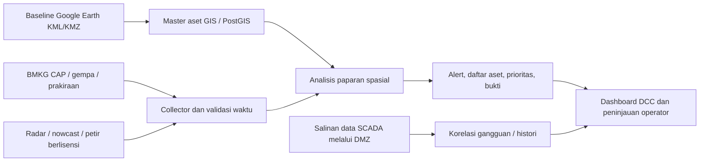

# Disaster Center DCC 20 kV — Sumatera Barat

Catatan pembaruan 28 Oktober 2026: dokumen ini dipertahankan sebagai rancangan awal prototipe. Spesifikasi aktif bernama **Web App Disaster Information Center**, versi 0.3, pada [PRD.md](./PRD.md). ArcGIS kini menjadi sumber utama aset yang direncanakan; Google Earth/KML adalah impor/cadangan. Windy ditambahkan sebagai kandidat visualisasi dan Marco ditunda. Perencanaan tagging, polygon, rekap pelanggan, foto serta peran pengguna mengikuti PRD dan [skema data](./SKEMA-DATA-DAN-KONEKTOR.md).

Rancangan awal dan prototipe, 28 Oktober 2026. Cakupan seluruh Sumatera Barat sesuai konfirmasi pengguna. Proyek Google Earth pengguna merupakan baseline aset; isi proyek belum berhasil diambil dari tautan. Tidak ada aset asli atau koneksi SCADA yang diasumsikan tersedia.

## Keputusan yang disarankan

Mulai dengan peringatan resmi BMKG dan baseline aset yang tervalidasi. Untuk sasaran “hujan diperkirakan mencapai jaringan dalam beberapa menit”, tambahkan data radar/nowcast bergeoreferensi yang berlisensi dan teruji di Sumatera Barat. Untuk risiko gangguan petir, tambahkan deteksi petir aktual bila akses BMKG yang disepakati belum mencukupi. API prakiraan titik saja tidak memenuhi sasaran pelacakan sel hujan.

Google Earth berfungsi sebagai sumber baseline dan alat pemeriksaan visual. Aplikasi pemantauan memiliki mesin GIS sendiri agar dapat menghitung irisan area bahaya dengan aset. Jangan menempatkan overlay terpisah di atas iframe Google Earth: keselarasan koordinat, kamera, dan perhitungan paparan tidak akan terjamin.

## Konektor BMKG

| Produk | Endpoint resmi | Peran dalam DCC |
|---|---|---|
| Prakiraan desa/kelurahan | `https://api.bmkg.go.id/publik/prakiraan-cuaca?adm4={kode}` | Perencanaan kesiapan per wilayah |
| Feed peringatan aktif | `https://www.bmkg.go.id/alerts/nowcast/id` | Menemukan peringatan resmi, lalu memilih Sumatera Barat |
| Detail peringatan CAP | Ikuti `link` dalam feed: `https://www.bmkg.go.id/alerts/nowcast/id/{kode_detail_cap}_alert.xml` | Area, masa berlaku, isi peringatan |
| Gempa terbaru | `https://data.bmkg.go.id/DataMKG/TEWS/autogempa.json` | Kejadian nasional untuk penilaian awal |

Prakiraan menyediakan tiga hari dengan interval tiga jam dan diperbarui dua kali sehari. Parameter lokasi menggunakan kode administrasi tingkat IV, bukan latitude/longitude. Dokumentasi menyebut batas 60 permintaan per menit per IP dan kewajiban atribusi BMKG. Ini prakiraan, bukan pengukuran cuaca langsung. [Dokumentasi prakiraan BMKG](https://data.bmkg.go.id/prakiraan-cuaca/).

Peringatan menggunakan RSS dan detail XML Common Alerting Protocol, dengan cakupan sampai kecamatan. Gunakan `effective`, `expires`, `status`, `msgType`, `references`, serta geometri yang benar-benar tersedia. CAP merupakan wilayah peringatan, bukan bentuk pasti awan atau hasil radar. Sumber yang sama mendokumentasikan batas akses dan atribusi. [Dokumentasi CAP BMKG](https://data.bmkg.go.id/peringatan-dini-cuaca/).

Dalam data gempa, `Coordinates` berurutan lintang,bujur. Untuk GeoJSON ubah menjadi bujur,lintang. Magnitudo dan jarak episenter tidak cukup untuk menyatakan gardu mengalami kerusakan: kaji intensitas guncangan/MMI, lokasi, dan laporan lapangan. [Dokumentasi gempa BMKG](https://data.bmkg.go.id/gempabumi/).

Desain konektor produksi:

1. Satu collector pusat mengunduh feed setiap 60 detik; interval ini usulan desain, bukan jaminan latensi BMKG. Ikuti detail CAP dari feed dan batasi ke Sumatera Barat. Deduplicasi berdasarkan identitas dan revisi peringatan.
2. Simpan waktu publikasi, mulai berlaku, kedaluwarsa, waktu pengambilan, dan status kegagalan. Kesalahan koneksi menghasilkan “data tidak tersedia”, bukan “aman”. Proses Update/Cancel dan referensinya sebelum menghitung paparan.
3. Kelompokkan aset menurut ADM4 hasil spatial join dengan batas administrasi terverifikasi. Ambil prakiraan per kode wilayah unik, bukan per tiang. Lakukan pembaruan bertahap dengan cache dan antrean agar seluruh pengguna berbagi kuota.
4. Saat HTTP 429 atau kegagalan berulang, terapkan backoff dan `Retry-After`; jangan menambah frekuensi. Simpan salinan terakhir dengan penanda kedaluwarsa.
5. Adapter terpisah memudahkan penambahan feed radar atau petir tanpa mengubah identitas aset.

Prototipe sudah menyediakan rute `/api/bmkg` dengan tujuan upstream tetap, validasi parameter, timeout, cache, deduplikasi permintaan paralel, dan pembatasan 40 permintaan/menit per instans. Pembatasan ini **belum** menjadi kuota global lintas replika. Produksi membutuhkan collector tunggal atau pengatur kuota bersama. Prakiraan dalam prototipe dimuat manual per kode, belum mencakup otomatis semua desa.

## Radar, nowcast dan layanan premium

Endpoint terbuka yang diverifikasi di atas tidak menyediakan rangkaian raster radar untuk menghitung lintasan hujan. Mintakan jalur resmi BMKG untuk produk radar dan/atau nowcasting serta metadata geospasial, frekuensi pembaruan, batas cakupan, izin penggunaan, dan mekanisme dukungan. Dokumentasi publik bukan bukti ketersediaan atau SLA feed khusus bagi PLN. [Jalur integrasi/kerja sama BMKG](https://www.bmkg.go.id/ketentuan-penggunaan).

| Kandidat | Kegunaan | Hal yang wajib diuji sebelum kontrak |
|---|---|---|
| BMKG melalui kerja sama resmi | Prioritas untuk sumber radar lokal dan peringatan resmi | Produk yang tersedia, cakupan radar Sumbar termasuk hambatan topografi, koordinat grid, histori, latensi dan SLA |
| Tomorrow.io paket premium/enterprise | Kandidat prakiraan menit dan layanan cuaca terintegrasi | Ketersediaan persis untuk Sumbar, sumber observasi vs model, horizon nowcast, grid spasial, izin tampilan dan SLA |
| Vaisala Xweather Lightning | Kandidat deteksi petir untuk korelasi gangguan jaringan | Cakupan dan kualitas lokal, tipe CG/IC, latency, ketelitian lokasi, histori dan hak korelasi |

Tomorrow.io mendokumentasikan prakiraan per menit premium untuk satu jam ke depan. Konfirmasi cakupan dan produknya untuk Sumbar melalui uji lapangan; jangan menyamakan semua produk global dengan observasi radar lokal. [Dokumentasi forecast](https://docs.tomorrow.io/reference/weather-forecast).

Xweather mendokumentasikan endpoint petir global real time dan opsi enterprise untuk pencarian area serta histori lebih luas. Paket standar memiliki batas radius, jumlah kejadian, dan jendela waktu. Evaluasi kemampuan di lokasi aset sebelum memilih paket. [Dokumentasi petir Xweather](https://www.xweather.com/docs/weather-api/endpoints/lightning).

Biaya enterprise harus diminta melalui penawaran sesuai area, volume, histori dan SLA; belum ada biaya berlangganan yang disepakati. Lakukan pilot lintas beberapa kejadian hujan/petir, cocokkan dengan laporan gangguan dan waktu SCADA, lalu ukur keterlambatan data, missed event, false alarm, dan manfaat waktu persiapan. Prioritas belanja ditentukan hasil pilot, bukan banyaknya parameter API.

## Pilihan tampilan Google

- **Operasi harian:** Google Maps Platform dengan basemap satelit/hybrid dan overlay aset serta cuaca. Ini aplikasi yang menggunakan layanan Google, bukan penyematan sesi Google Earth pengguna.
- **Tampilan 3D:** CesiumJS dengan Google Photorealistic 3D Tiles bila cakupan lokal dan kebutuhan perangkat memadai. Perlu billing, API key dan atribusi. Verifikasi cakupan 3D setiap wilayah; jangan menjanjikan semua Sumbar memiliki mesh rinci. [Dokumentasi Google](https://developers.google.com/maps/documentation/tile/3d-tiles).
- **Prototipe saat ini:** Leaflet dan OpenStreetMap 2D. Peta Google, elevasi 3D, radar dan animasi awan belum diimplementasikan. Tile publik OSM bersifat best effort; untuk operasi 24/7 gunakan penyedia ber-SLA atau tile internal yang sesuai lisensi. [Kebijakan tile OSM](https://operations.osmfoundation.org/policies/tiles/).

Ekspor proyek Google Earth sebagai KML melalui menu proyek dan impor geometri ke sistem. [Petunjuk ekspor Google Earth](https://www.google.com/earth/outreach/learn/create-a-map-or-story-in-google-earth-web/). Ekspor bukan sinkronisasi otomatis: tetapkan versi baseline, penanggung jawab, dan proses pembaruan.

## Model data aset

Data minimum: `asset_id` stabil, nama, jenis, koordinat WGS84, `feeder_id`, GI/sumber, UP3/ULP, ADM4, waktu pembaruan dan versi baseline. Untuk gardu tambahkan kapasitas/criticality bila disetujui. Untuk jalur simpan geometri LineString/MultiLineString dan sambungannya, bukan hanya titik ujung. Untuk pengaitan SCADA butuh tabel `asset_id ↔ feeder_id ↔ SCADA tag` yang diperiksa tim operasi.

ID sesi yang dibuat prototipe bukan identitas master untuk produksi. Klasifikasi jenis berdasarkan nama dalam prototipe hanya bantuan awal; verifikasi field jenis pada master aset. Aset dalam GeometryCollection dapat dianalisis tetapi klasifikasi per jenis memerlukan normalisasi.

## Cara alert bekerja

Untuk CAP, uji irisan titik dan koridor jalur dengan polygon peringatan. Koridor adalah toleransi analisis, bukan batas bahaya resmi. Satu area CAP bisa mencakup jaringan yang belum mengalami hujan, sehingga hasil diberi nama “paparan peringatan”.

Untuk radar/nowcast, gunakan urutan frame atau field prakiraan hujan yang diketahui waktu valid dan proyeksinya. Periksa irisan lintasan/area prakiraan pada horizon misalnya 15, 30 dan 60 menit dengan koridor jaringan. Tampilkan estimasi waktu tiba beserta ketidakpastian dan waktu update. Jangan menghitung gerak awan hanya dari arah angin prakiraan permukaan atau dari satu gambar radar. Citra satelit awan tidak identik dengan hujan di permukaan.

Contoh format alert setelah data lengkap: “Penyulang [ID] — [jumlah] gardu dan [panjang] km ruas berada dalam area peringatan BMKG, berlaku sampai [waktu].” Label “prediksi mencapai ruas dalam [rentang] menit” hanya diaktifkan jika ada data nowcast yang mendukung. Mitigasi mengacu pada SOP lokal: tinjau lokasi, kesiapan petugas/peralatan, pantau beban dan gangguan, dokumentasikan hasil penilaian. Sistem tidak memutus atau memindahkan beban otomatis.

Produksi perlu backend yang terus bekerja saat browser ditutup, antrean notifikasi, deduplikasi, prioritas, eskalasi, audit pengguna, dan penyimpanan acknowledgment. Bunyi dan penandaan prototipe hanya berlaku dalam sesi browser; belum ada pengiriman WhatsApp/SMS/email. Buat aturan cooldown dan hysteresis untuk mencegah alarm berulang.

Untuk banjir/longsor, tambahkan peta kerawanan dan observasi hidrologi yang relevan dari instansi berwenang. Hujan lebat atau tutupan awan saja tidak cukup untuk menyatakan suatu gardu akan terendam. Akses, lisensi, resolusi dan waktu pembaruan setiap lapisan harus diverifikasi terpisah.

## Hubungan dengan SCADA dan tahapan produksi

Dashboard dapat dipasang di monitor/video wall yang berdampingan dengan SCADA terlebih dahulu. Akses internet untuk cuaca ditempatkan di jaringan aplikasi yang sesuai kebijakan PLN. Integrasi berikutnya menggunakan salinan telemetri/event baca saja melalui DMZ atau historian yang disetujui. Jangan menghubungkan server pengambil cuaca internet langsung ke jalur kontrol switching.

Tahapan berikutnya:

1. Terima KML/KMZ asli, periksa kelengkapan aset dan jalur, verifikasi ID/penyulang serta sistem koordinat.
2. Migrasikan baseline ke GIS tersimpan dan aktifkan Google basemap dengan akun/key organisasi sesuai pilihan tampilan.
3. Uji akses BMKG dari jaringan produksi. Tetapkan collector, kuota bersama, monitoring dan penanganan data gagal.
4. Pilot radar/nowcast dan petir untuk beberapa penyulang representatif sebelum memperluas seluruh Sumbar.
5. Verifikasi korelasi dengan histori gangguan SCADA, persistence, audit, alarm fatigue, hak akses operator dan penerimaan operasi.

Kriteria penerimaan: tidak ada klaim aman saat sumber gagal; peringatan kedaluwarsa/batal tidak aktif; semua asset ID dapat ditelusuri; waktu tampil konsisten WIB; baseline tidak hilang; notifikasi tetap berjalan tanpa browser; data dan mitigasi dapat diaudit; estimasi waktu tiba memiliki bukti kualitas lokal.

## Status verifikasi prototipe

Konektor server lokal berhasil mengambil RSS peringatan BMKG dan JSON gempa. Pada snapshot uji, feed tidak memuat item Sumatera Barat; ini tidak membuktikan wilayah bebas risiko. Belum ada validasi CAP Sumbar aktual yang aktif. Parsing CAP multilingual/geometri dan analisis spasial diperiksa dengan fixture sintetis, bukan data jaringan PLN. Pemeriksaan tipe dan sembilan pengujian otomatis lulus; build aplikasi berhasil. Simulasi menghasilkan sembilan fitur dan enam paparan untuk memeriksa alur peta/alert.
